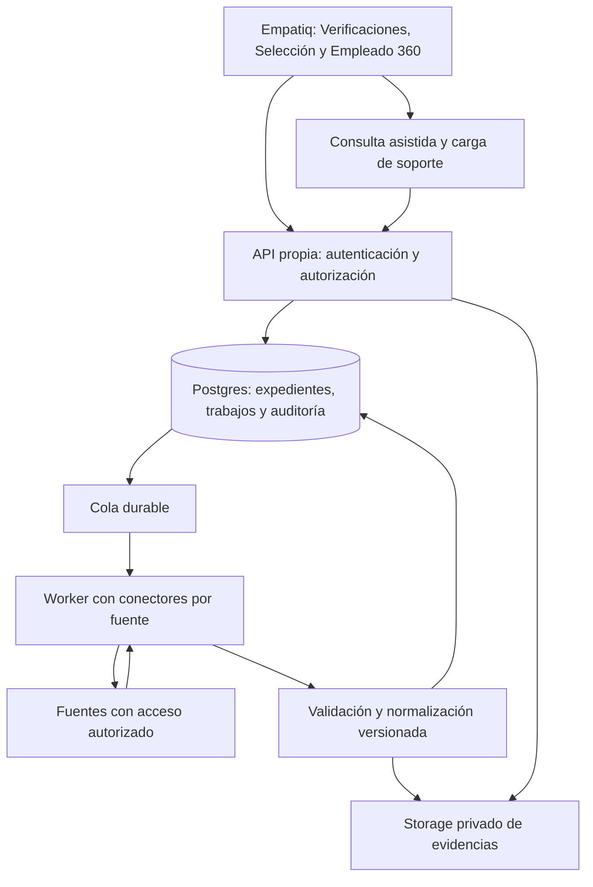

# Plan de implementación: Verificaciones de Empatiq

Fecha: 14 de octubre de 2026. Estado: propuesta técnica lista para iniciar descubrimiento e implementación por fases. Este documento no implica que los conectores estén implementados, autorizados o probados en producción.

## 1. Objetivo y alcance

Construir un módulo propio para verificar información de candidatos y empleados, sin utilizar CoreSoft ni otro agregador como dependencia obligatoria. Empatiq será responsable de la interfaz, los conectores directos, la normalización, las evidencias, el historial y la revisión humana.

El alcance comprende exactamente once capacidades: Cédula, Antecedentes Policía, Procuraduría, Contraloría, Rama Judicial, EPS/ADRES, Licencia de Conducción, Certificados de Aportes, Planilla SIMPLE, SOI-Aportes y Verificación Laboral.

La independencia del agregador no elimina la dependencia de los organismos y operadores que administran los datos. La existencia de un formulario ciudadano no prueba que exista una API disponible para Empatiq, ni autoriza su automatización.

Dos entregas diferenciadas:

1. **Módulo operativo:** las once capacidades disponibles para gestionar solicitudes y evidencias, con consulta asistida o documental donde corresponda. La interfaz identifica el método y las limitaciones de cada resultado.
2. **Automatización por fuente:** conectores directos habilitados individualmente después de verificar acceso, alcance, condiciones de uso y calidad. No se declarará automatización completa por haber terminado únicamente la interfaz.

Quedan fuera de la primera entrega: decisiones automáticas de contratación, puntuación de riesgo de personas, búsqueda indiscriminada de terceros, vigilancia recurrente de toda la plantilla, intermediación comercial de consultas, datos ajenos a las once capacidades y pagos o liquidación de PILA.

## 2. Encaje con el código actual

Inspección del repositorio, sin modificación del código funcional:

| Pieza existente | Uso previsto |
| --- | --- |
| `src/routes/workspaceRoutes.tsx` y `src/components/layout/Sidebar.tsx` | Registrar `/verificaciones` y su entrada de navegación. |
| `src/components/selection/CandidateDetailDialog.tsx` | Agregar pestaña de verificaciones y creación contextual de solicitudes. |
| `src/pages/Empleado360.tsx` | Agregar pestaña en la sección Control, con carga diferida. |
| `src/types/vacancy.ts` y `src/types/employee.ts` | Reutilizar documento y fecha de expedición; solicitar campos faltantes sin inventarlos. |
| `src/contexts/AuthContext.tsx` y `src/lib/permissionMatrix.ts` | Integrar permisos explícitos por módulo, empresa y ámbito del usuario. |
| `src/hooks/useCandidates.ts` | Vincular el expediente del candidato con el empleado al contratar, conservando procedencia. |
| `src/hooks/useCandidateBackground.ts` | Mantener independiente: consulta antecedentes internos, candidaturas y procesos internos; no son antecedentes oficiales. |
| `src/pages/PilaUgpp.tsx` y `src/hooks/usePilaUgpp.ts` | Presentar evidencias externas junto al período pertinente, sin reemplazar cálculos o validaciones internas. |
| `src/lib/auditService.ts` | Integrar visualización de eventos; su registro desde el navegador es complementario, no la única auditoría de estas operaciones. |

Las tablas actuales de referencia incluyen `candidates`, `vacancies`, `employees_v2` y `candidate_documents`. Confirmar llaves, políticas y restricciones contra el esquema del entorno de desarrollo antes de crear migraciones. No modificar archivos de otros trabajos presentes en el checkout.

## 3. Matriz de fuentes y aceptación por capacidad

Estado inicial: se han consultado portales y documentación pública; no se han probado consultas personales ni obtenido convenios. Cada fila exige una ficha técnica durante la fase 0.

| Capacidad / código | Fuente prevista y datos de entrada | Primera modalidad y condición para automatizar | Resultado mínimo aceptable |
| --- | --- | --- | --- |
| Cédula / `identity` | Registraduría; tipo y número de documento, más requisitos del canal autorizado. | Documento aportado y revisión asistida. Validación oficial automática condicionada a acceso autorizado. OCR no equivale a identidad verificada. | Datos contrastados, fuente, coincidencias y alcance explícito de la validación. |
| Policía / `police` | Consulta oficial; documento y requisitos del formulario vigente. | Asistida inicialmente; evaluar canal permitido antes de construir conector automático. | Texto de respuesta, identificación consultada y evidencia fechada. |
| Procuraduría / `procuraduria` | Portal de consulta, expedición y verificación; documento y número de certificado cuando aplique. | Asistida/documental; automatizar solo con canal y condiciones comprobados. | Certificado o respuesta, fecha y estado de comprobación de autenticidad. |
| Contraloría / `contraloria` | Certificado oficial de responsabilidad fiscal; tipo y número de documento. | Asistida/documental; validación técnica y de acceso previa al conector. | Certificado, identidad y fecha verificables. |
| Rama Judicial / `judicial_processes` | CPNU; nombre o razón social y/o radicado, según modalidad. | Asistida. Sus condiciones publicadas restringen robots; automatización pendiente de autorización o canal específico. | Procesos, partes, rol procesal, radicado y coincidencia de identidad pendiente de revisión cuando solo exista nombre. |
| EPS/ADRES / `health_affiliation` | BDUA; tipo y número de documento. | Asistida, dado el CAPTCHA de la consulta ciudadana; automatización solo por acceso permitido. | EPS, estado de afiliación y fecha de consulta; conservar fechas de reporte si la fuente las entrega. |
| Licencia / `driving_license` | RUNT; documento y datos adicionales que exija el canal vigente. | Asistida/documental; validar acceso directo y alcance. | Categorías, estado y vencimientos reportados, sin interpretar un error como ausencia de licencia. |
| Certificados de Aportes / `contribution_certificate` | Inicialmente Aportes en Línea; documento, fecha de expedición, EPS y rango de períodos. | Certificado aportado o consulta asistida; estudiar acceso autorizado del operador. | Soporte original, operador, período, aportante y datos extraídos revisables. |
| SIMPLE / `simple_contributions` | SIMPLE; cuenta/alcance autorizado, cotizante y período. | Prioridad para prueba de integración directa: anuncia APIs empresariales, cuyo alcance exacto debe confirmarse. | Soporte y registros del período realmente cubierto por la integración. |
| SOI / `soi_contributions` | SOI; datos del aportante/cotizante y período que requiera su servicio. | Asistida/documental; evaluar integración autorizada con el operador. | Certificado, período, administradoras y aportante cuando estén presentes. |
| Verificación laboral / `employment_verification` | Motor propio sobre evidencias autorizadas de aportes, certificados y referencias. | Revisión documental y síntesis de evidencias; automatización de extracción y comparación, con conclusión humana. | Empleador reportado, períodos respaldados, fuente y discrepancias; vigencia actual sin confirmar si la evidencia no la demuestra. |

La ausencia de un registro en un operador no demuestra ausencia de aportes en otros. Un proceso judicial no equivale a una condena. Una coincidencia de nombre no permite atribuir un proceso a una persona. Un certificado cargado se mostrará como aportado hasta comprobar su autenticidad por un método verificable.

## 4. Recorrido del usuario

1. Abrir Verificaciones o la pestaña de un candidato/empleado accesible.
2. Seleccionar capacidades pertinentes para la finalidad y el cargo; ninguna consulta se dispara por abrir una ficha.
3. Revisar datos disponibles, finalidad, fundamento/autorización aplicable y campos faltantes. Seleccionar período para aportes.
4. Ver método disponible por fuente: conexión directa, consulta asistida, evidencia documental o no disponible. Mostrar coste estimado solo cuando haya tarifa confirmada.
5. Crear expediente y ejecutar las verificaciones habilitadas. Mostrar progreso independiente; cerrar la página no cancela el trabajo persistido.
6. En consulta asistida, abrir el portal oficial para que la persona autorizada complete su paso y adjunte la evidencia. No prometer incrustación del portal ni lectura automática entre dominios. CAPTCHA o autenticación pendiente se presentan como acción requerida.
7. Revisar resumen y documentos, resolver discrepancias y registrar observación con responsable y fecha.
8. Generar informe de Empatiq con método, cobertura y procedencia. El informe no se presenta como certificado emitido por una entidad oficial.

Pantallas: bandeja filtrable; nueva solicitud; detalle con once tarjetas; visor de evidencias; historial de revisiones; configuración de fuentes y retención. En fichas se mostrará el resumen mínimo y acceso al detalle según permisos. La carga completa de datos sensibles será diferida.

## 5. Arquitectura propuesta

Decisión inicial: conservar React/TypeScript y Supabase del proyecto. Usar Edge Functions para operaciones breves de autorización y orquestación; Postgres para estados y cola durable. Evaluar Supabase Queues/pgmq en el entorno antes de activarlo. Si no está disponible, implementar una tabla privada de trabajos con reclamación atómica y lease, sin cambiar el contrato del módulo.

Un worker propio en contenedor ejecutará trabajos largos, extracción de documentos y, únicamente cuando proceda, interacciones permitidas con fuentes. No depender de una petición HTTP abierta ni de `waitUntil` como garantía de durabilidad. Supabase documenta límites de duración de sus tareas en segundo plano [S12]. Desplegar el worker solo cuando haya un conector aprobado que lo necesite; la versión asistida puede operar sin él.

Cada conector declara: código, versión, modalidad, campos y tipos admitidos, cobertura, credenciales requeridas, límite de concurrencia, timeout, errores recuperables y parser. Ninguna URL arbitraria proporcionada por el cliente se ejecuta como destino de consulta.

Contrato normalizado de salida: estado técnico, resultado por fuente, identidad consultada, modalidad, fecha de consulta, período de evidencia, versión del conector, campos obtenidos, campos ausentes, referencias de evidencias y limitaciones. El backend conserva el detalle necesario; el navegador recibe exclusivamente lo permitido.

## 6. Modelo de datos propuesto

Los nombres son nuevos y se confirmarán en la fase 1. Todas las entidades que contengan información de personas tendrán `company_id` y controles por sujeto; las relaciones entre entidades deben impedir asociaciones entre empresas.

| Entidad | Contenido y restricciones |
| --- | --- |
| `verification_cases` | Expediente: empresa, candidato y/o empleado vinculados, finalidad, solicitante, fechas y estado agregado. Debe existir al menos un sujeto válido; si hay ambos, validar su relación y empresa. |
| `verification_checks` | Una capacidad por expediente/solicitud: fuente, modalidad, parámetros mínimos protegidos, período, versión, estado técnico y resultado. Reconsultar crea una nueva ejecución conservando la anterior. |
| `verification_jobs` | Cola/seguimiento privado: referencia de check, intento, idempotencia, lease, próximo intento, error sanitizado y cancelación. No enviar nombres o documentos completos en mensajes de cola. |
| `verification_evidence` | Metadatos del archivo privado: origen, método de obtención, hash de integridad, tamaño, tipo, fecha, período, autenticidad comprobada o pendiente y vencimiento de retención. Un hash prueba integridad, no autenticidad. |
| `verification_authorizations` | Fundamento/finalidad, evidencia de autorización cuando corresponda, versión del texto, capacidades cubiertas, fecha y revocación. Una autorización del titular no reemplaza el permiso de acceso de la fuente. |
| `verification_reviews` | Revisión humana anexada al resultado: observaciones, discrepancias, identidad pendiente/resuelta, autor y fecha. Conservar versiones en vez de sobrescribir evidencia. |
| `verification_events` | Eventos de servidor: creación, ejecución, lectura de detalle, descarga, revisión, cancelación, cambios de configuración y eliminación por retención. |
| `verification_source_settings` | Activación por empresa/capacidad, modalidad permitida, retención y límites. Guardar referencias a secretos, nunca credenciales visibles al cliente. |

Guardar solo los campos necesarios. No persistir por defecto respuestas completas que incluyan direcciones, ingresos estimados u otros datos no pertinentes. Separar payload técnico temporal de resultados necesarios para RRHH; ambos tienen políticas de eliminación.

Índices iniciales: empresa y fecha para bandeja; empresa y candidato/empleado para historial; expediente y capacidad para detalle; estado y próximo intento para jobs. Índice único de idempotencia por empresa y solicitud para evitar dobles clics. Para reutilización, usar además sujeto, fuente, período, parámetros y versión; nunca compartir caché de personas entre empresas.

Al contratar, vincular el expediente existente al empleado validando la relación. No copiar evidencias al bucket genérico si ello amplía acceso. En traslado de candidato a otra empresa, no trasladar automáticamente verificaciones; exigir evaluación de acceso y finalidad. Rectificación y eliminación de sujetos deben respetar dependencias y retención, sin borrar pruebas por cascada accidental.

## 7. Autorización, documentos y trazabilidad

Crear módulos `verificaciones` y `verificaciones_configuracion` usando acciones existentes:

| Permiso | Operación |
| --- | --- |
| `verificaciones:view` | Ver expedientes/resultados del ámbito autorizado. |
| `verificaciones:create` | Solicitar consultas o aportar evidencia para un sujeto autorizado. |
| `verificaciones:update` | Completar campos, cancelar solicitudes propias permitidas y anexar revisión. No modificar resultados originales. |
| `verificaciones:export` | Obtener evidencias e informes. |
| `verificaciones_configuracion:view/update` | Consultar o cambiar modalidades, límites y políticas por empresa. |

No otorgar estos permisos automáticamente a todos los roles del sistema. Validar también asignación a empresa, centros y acceso al candidato/vacante o empleado. No basar el acceso únicamente en que un botón esté oculto o que el usuario conozca un ID. La fase 1 deberá identificar las funciones de autorización actuales y probar su alcance real, especialmente el acceso a candidatos confidenciales.

RLS en tablas expuestas y Storage. El cliente no puede escribir resultados oficiales ni transiciones de ejecución; las mutaciones se realizan por operaciones controladas. Workers y cola usan credenciales de servidor con alcance mínimo. Cada reclamación revalida que la fuente y autorización sigan vigentes; revocaciones cancelan trabajos aún no enviados. No confiar en `user_metadata` para autorizar.

Bucket privado propuesto `verification-evidence`: acceso por expediente, rutas no predecibles y URLs de corta duración. Auditar la emisión de enlaces; para revocación inmediata, servir archivos a través de un endpoint que reautorice, ya que una URL firmada puede seguir siendo utilizable hasta su vencimiento. Validar tamaño, MIME y contenido de archivos; cuarentena y análisis antes de procesar PDFs. No ejecutar contenido de documentos ni enviarlos a IA externa por defecto.

La auditoría de creación, cambios y revisión se escribe en el servidor, en la misma transacción que la operación cuando sea posible. Los eventos de lectura/descarga se registran antes de entregar el recurso. Evitar respuestas completas o números de documento en logs generales, URLs del frontend y servicios de telemetría.

Definir antes del piloto duración de retención por finalidad, eliminación de archivos y datos derivados, excepciones justificadas y tratamiento de copias de respaldo. No inventar un período legal universal.

## 8. Estados, fallos y operación

Separar tres dimensiones:

- **Ejecución:** pendiente, en cola, ejecutando, requiere acción, completada, fallida, cancelada, no disponible.
- **Resultado de fuente:** con información, sin registros en el alcance consultado, inconcluso, no aplica.
- **Revisión:** pendiente, revisada, requiere aclaración. Nunca apto/no apto generado automáticamente.

El expediente muestra resultados parciales si una fuente falla. Un timeout, un CAPTCHA o un cambio de HTML produce fallo/acción requerida, nunca «sin antecedentes». Un PDF ilegible produce extracción incompleta y queda disponible para revisión.

Procesamiento: creación del check y encolado de forma atómica; reclamación con lease; límite por fuente; backoff con jitter para errores transitorios; máximo inicial configurable de tres intentos automáticos; sin reintentos automáticos ante credenciales inválidas, restricción de acceso o CAPTCHA. Ante cambio de estructura, pausar el conector hasta validar el parser.

Reentrega de cola no debe duplicar evidencias o resultados. No prometer ejecución externa exactamente una vez: si la fuente respondió y falló la persistencia, registrar resultado incierto y conciliar antes de repetir una operación con coste. Conservar identificador externo cuando exista.

Deshabilitar una fuente detiene nuevos envíos y jobs pendientes. El historial permanece sujeto a sus permisos y retención. Cancelar un trabajo no puede deshacer datos ya transmitidos; impedir nuevas etapas y reflejar el estado real.

Métricas sin datos personales: éxito/fallo por fuente, tiempos p50/p95, antigüedad de cola, intentos, intervención humana, extracción incompleta y coste conocido. Separar fallo técnico de ausencia de registros. Alertas operativas por cambios de formato o aumento de errores; botón de pausa por conector.

## 9. Fases, entregables y condiciones de salida

### Fase 0 — Viabilidad de acceso y alcance (3–5 días de trabajo)

- Crear una ficha para cada una de las once capacidades: titular de la fuente, URL/canal, datos requeridos, cobertura, permisos/contratos, tarifa, cuotas, evidencia y método alternativo.
- Priorizar conversación técnica sobre APIs de SIMPLE y condiciones de acceso de Registraduría; preparar solicitudes, sin enviarlas automáticamente como parte de este plan.
- Verificar qué fuentes admiten integración directa. Mantener Rama Judicial en asistido salvo autorización específica.
- Definir finalidad, ámbito de usuarios, política de documentos y retención con el responsable de la empresa.
- Usar ejemplos sintéticos para desarrollo y casos autorizados para validación real. No reutilizar datos de producción encontrados en archivos del repositorio.

**Salida:** matriz con modalidad decidida por fuente: automática autorizada, asistida/documental o bloqueada con razón. Las esperas de convenios no bloquean la construcción del núcleo.

### Fase 1 — Base de datos y permisos (4–6 días)

- Implementar tablas, restricciones, RLS, Storage privado y catálogo de permisos.
- Definir contrato de resultados y validación de entradas por fuente.
- Construir operaciones de expediente, evidencia y revisión con auditoría de servidor.
- Probar aislamiento entre empresas, centros, candidatos y empleados antes de mostrar datos en UI.
- Generar migraciones reproducibles desde entorno de desarrollo y actualizar tipos generados. Seguir el flujo de migración del proyecto; no alterar producción en esta fase.

**Salida:** backend probado con datos sintéticos, acceso denegado fuera de ámbito y evidencias inaccesibles por URL pública.

### Fase 2 — Interfaz y primera entrega asistida (5–8 días)

- Crear bandeja, formulario, detalle por fuente, visor y revisión.
- Integrar Selección y Empleado 360 con permisos explícitos y queries separadas por empresa/sujeto.
- Habilitar once capacidades con modalidad real visible; registrar carga de soportes y asistencia.
- Añadir informe propio con cobertura, fechas, responsable y advertencias específicas del resultado.
- Validar móvil, teclado, estados vacíos y cambio de empresa durante solicitudes en curso.

**Salida:** un usuario autorizado completa el recorrido documental/asistido y recupera el historial. No se presenta ningún resultado simulado como consulta real.

### Fase 3 — Motor durable y primer conector (5–8 días, acceso ya disponible)

- Implementar cola, worker cuando aplique, reclamación, idempotencia, límites y pausa.
- Integrar la primera fuente autorizada elegida tras fase 0; SIMPLE es candidato por su oferta pública de APIs, no un acceso ya concedido.
- Versionar parser y fixtures anonimizadas; guardar evidencia original cuando esté permitido.
- Probar interrupción del worker, reentrega, expiración de credenciales y resultados parciales.

**Salida:** consulta directa de extremo a extremo con evidencia, auditoría y manejo de fallo demostrado. Si no hay acceso aprobado, esta fase queda pendiente y la entrega asistida sigue utilizable.

### Fase 4 — Extensión de fuentes y cruces (3–6 días por conector sencillo como hipótesis)

- Incorporar por separado identidad, antecedentes, afiliación/licencias y operadores de aportes según disponibilidad real.
- Cada conector supera los mismos controles antes de activarse. Reestimar los que exijan protocolos, convenios o navegación compleja.
- Añadir comparación de aportes por período con PILA/UGPP, sin convertir una estimación interna en pago confirmado.
- Implementar verificación laboral como expediente de evidencias: empleador reportado, períodos, referencias y discrepancias. Mostrar cobertura incompleta sin inferir desempleo o incumplimiento.
- Ofrecer lotes acotados solo después de validar volumen permitido y aislamiento; sin consultas periódicas por defecto.

**Salida:** checklist individual firmado técnicamente por conector y modalidad publicada honestamente. La cobertura final se reporta por capacidad, no con una etiqueta global «todo funciona».

### Fase 5 — Piloto y salida gradual (4–6 días)

- Piloto en una empresa designada, 10–20 expedientes autorizados, perfiles de acceso distintos y escenarios de fallo.
- Revisar identidad, resultados, soportes, tiempos, consumo y cobertura con RRHH.
- Activar con flags por empresa y fuente; mantener rollback operativo por conector.
- Documentar soporte, rotación de credenciales, incidentes y revalidación de parsers.

**Salida:** ninguna exposición entre empresas en pruebas, trazabilidad completa de los casos piloto, ausencia de defectos bloqueantes y límites conocidos documentados.

Estimaciones de esfuerzo para una persona con dedicación principal: fases 0–2, 12–19 días hábiles; núcleo con primer conector y piloto, 21–33 días hábiles. Son rangos de planificación, no fechas comprometidas. No incluyen tiempos de respuesta de entidades, tarifas, revisión externa ni conectores adicionales. No es posible fijar hoy una fecha responsable para once integraciones automáticas.

## 10. Archivos y paquetes de trabajo

| Paquete | Archivos propuestos o a modificar | Depende de |
| --- | --- | --- |
| Contratos | `src/types/verification.ts`, `src/lib/verifications/` | Ficha de capacidades |
| Persistencia | Nuevas migraciones en `supabase/migrations/`, `supabase/tests/verification_access.sql`, tipos de Supabase | Modelo y política de acceso |
| API | `supabase/functions/verification-api/index.ts`, `supabase/functions/_shared/verifications/` | Persistencia y permisos |
| Motor | `services/verification-worker/` si hace falta, módulo privado de jobs y conectores | Canal autorizado y contrato |
| UI | `src/pages/Verificaciones.tsx`, `src/components/verifications/`, `src/hooks/useVerifications.ts` | API básica |
| Navegación | `src/routes/workspaceRoutes.tsx`, `src/components/layout/Sidebar.tsx`, `src/lib/permissionMatrix.ts` | Registro de permisos |
| Fichas | `CandidateDetailDialog.tsx`, `Empleado360.tsx`, nuevo componente compartido de resumen | UI y autorización por sujeto |
| Contratación | `useCandidates.ts` y operación backend de vínculo | Relación candidato-empleado validada |
| PILA | `PilaUgpp.tsx` y enlace a evidencias por período | Conectores/documentos de aportes |
| Operación | `docs/verificaciones-operacion.md`, fichas de fuentes y fixtures sintéticas | Primer conector |

Dividir cambios revisables: persistencia/permisos; API; UI asistida; cola; primer conector; integraciones en fichas; cada conector adicional. No incluir secretos ni respuestas personales en commits.

## 11. Pruebas y definición de terminado

Pruebas necesarias, además del build y lint de archivos afectados:

1. **Acceso:** empresa A no lee ni modifica B; un usuario sin permiso no descarga evidencias; restricciones por centro y sujeto se cumplen tanto en API como en RLS. Alterar IDs o `company_id` del request no amplía acceso.
2. **Ciclo de vida:** crear, consultar, adjuntar, revisar, cancelar y reconsultar; transición candidato-empleado conserva la evidencia; cambio de empresa limpia caché sensible y descarta respuestas anteriores.
3. **Evidencias:** documento de otra persona, período erróneo, archivo corrupto o falso MIME, enlace vencido y eliminación por retención. Documento no autenticado nunca aparece como validación oficial.
4. **Conectores:** fixture válida, ausencia de registros, campos omitidos, cambio de estructura, acceso restringido y fuente caída. Sin coincidencia no es igual a fallo.
5. **Cola:** doble clic, worker reiniciado, lease vencido, reentrega, cancelación y autorización revocada. Ningún resultado se sobrescribe con un intento tardío.
6. **Semántica:** homónimos en procesos, aportes de períodos diferentes, ausencia en un solo operador y relación laboral no confirmada. No generar rechazo/selección automática.
7. **Auditoría:** actor, empresa, fuente, método y fechas presentes; datos personales ausentes de logs generales; lectura y descarga dejan evento de servidor.
8. **UI:** navegación por teclado, foco de diálogos, lectura de estados sin depender del color, vista estrecha y estados parciales.

Cada conector se considera terminado cuando existe acceso confirmado, contrato/alcance documentado, consulta real autorizada validada contra la fuente, pruebas de fallo, métricas, método alternativo y procedimiento de pausa. Un mock o una página con botón no satisface esta condición.

## 12. Despliegue, mantenimiento y costes

Entornos separados para desarrollo y piloto; credenciales distintas por entorno. Migraciones aditivas y despliegue del backend antes del frontend. Flags inicialmente desactivados. Probar restauración y borrado por retención en desarrollo; ante fallo en producción, detener conectores sin destruir expedientes.

Presupuesto por estimar tras la fase 0: almacenamiento/descarga de evidencias, ejecuciones/worker, observabilidad, tarifas de acceso por entidad y horas de mantenimiento. Fórmula inicial: infraestructura fija + consultas autorizadas × tarifa real + almacenamiento y transferencia + mantenimiento. No aplicar las tarifas de CoreSoft al módulo propio ni asumir consultas gratuitas por existir un portal público.

Responsabilidades propuestas: desarrollo para núcleo y conectores; responsable de RRHH para casos, finalidad y revisión; administrador de la empresa para accesos y convenios; operación técnica para secretos, alertas y recuperación. La implementación puede avanzar con casos sintéticos sin esperar datos personales.

## 13. Decisiones abiertas y valores iniciales

| Decisión | Valor propuesto mientras se valida |
| --- | --- |
| Entrada del módulo | Verificaciones dentro de Selección, con acceso contextual en Empleado 360. |
| Proveedor agregador | Ninguno. Conectores propios a fuentes autorizadas. |
| Primera entrega | Once capacidades documentales/asistidas; automatización publicada por fuente. |
| Fuente del primer conector | Elegir en fase 0; priorizar evaluación de SIMPLE. |
| Consultas masivas | Desactivadas hasta validar cuotas, finalidad y operación individual. |
| Consulta recurrente | Desactivada por defecto. |
| Empresa piloto y usuarios | Designar antes del piloto; no inferir autorización por tener datos en el repositorio. |
| Retención | Definir por finalidad antes de almacenar datos reales. |
| Alcance de credenciales | Por empresa cuando corresponda; no reutilizar credenciales de una empresa para otra. |

## 14. Referencias verificadas

Las fuentes describen canales y restricciones; no acreditan que Empatiq ya tenga acceso. Revalidar antes de implementar cada conector.

- [S1 — Registraduría: bases de identificación y acceso](https://www.registraduria.gov.co/IMG/pdf/bases_de_datos_de_identificacion-2.pdf).
- [S2 — Policía: consulta de antecedentes](https://www.policia.gov.co/contenido/consulta-antecedentes).
- [S3 — Procuraduría: consulta y verificación de certificados](https://www.procuraduria.gov.co/Pages/certificado-antecedentes.aspx).
- [S4 — Contraloría: certificado de persona natural](https://cfiscal.contraloria.gov.co/certificados/certificadopersonanatural.aspx).
- [S5 — Rama Judicial: modalidades de CPNU](https://www.ramajudicial.gov.co/web/guest/pregunta-cpnu). Las modalidades incluyen nombre y radicado; no equivalen a un acceso automático para terceros.
- [S6 — Rama Judicial: condiciones de uso](https://www.ramajudicial.gov.co/web/juzgados-administrativos/politicas-de-privacidad-y-condiciones-de-uso). Restricción publicada de consultas mediante robots hacia CPNU.
- [S7 — ADRES: consulta de afiliación](https://aplicaciones.adres.gov.co/bdua_internet/pages/consultarafiliadoweb.aspx).
- [S8 — RUNT: consulta ciudadana por documento](https://www.runt.gov.co/sites/default/files/RUNT2-IN-1009%20Consulta%20ciudadana%20por%20documento%20V1.pdf).
- [S9 — Aportes en Línea: certificado de aportes](https://servicios.aportesenlinea.com/Autoservicio/CertificadoAportes.aspx).
- [S10 — SIMPLE: integración empresarial vía APIs](https://pagosimple.com/seguridad-social-empresas/) y [consulta de certificados](https://pagosimple.com/consultas-y-certificados/). La oferta pública no determina aún la cobertura contractual disponible para Empatiq.
- [S11 — SOI: servicios empresariales y certificados](https://www.soi.com.co/empresa-centro-de-ayuda).
- [S12 — Supabase: tareas en segundo plano y límites](https://supabase.com/docs/guides/functions/background-tasks).
- [S13 — Supabase: colas durables](https://supabase.com/docs/guides/queues).
- [S14 — Supabase: control de acceso a Storage](https://supabase.com/docs/guides/storage/security/access-control).
